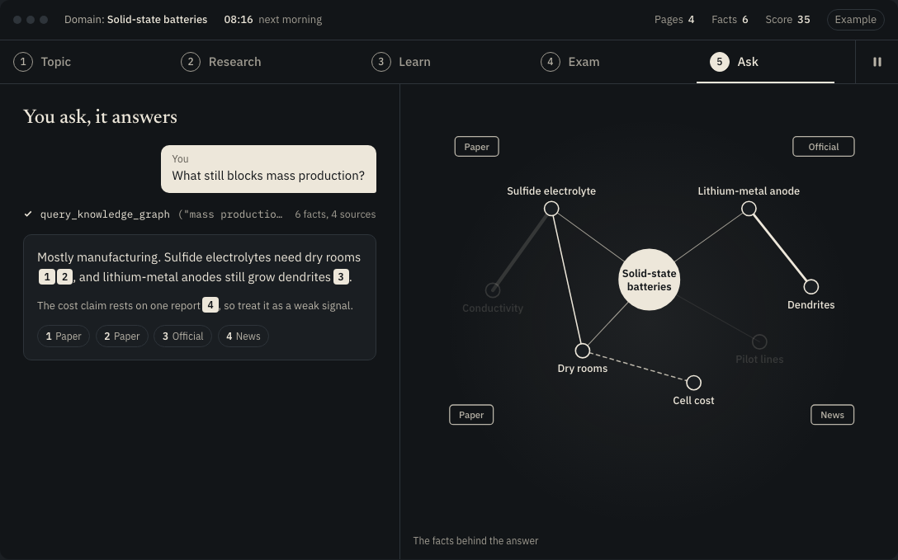
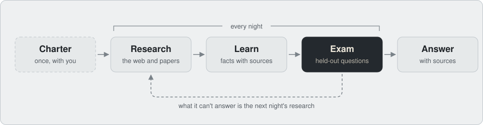

<p align="center"></p>
<h1 align="center">The Sovereign</h1>
<p align="center"><b>멈추지 않는 연구실.</b></p>
<p align="center">
  주제 하나를 주면, 매일 밤 웹과 논문을 읽고, 사실 하나하나를 출처와 함께 지식 그래프에 쌓고, 시험을 쳐서 무엇을
  배웠는지 보여줍니다. 그 주제에 대해 물으면 그래프에서 출처와 확신 정도를 붙여 답합니다. 오픈소스이고 직접 띄워
  쓰며, 로컬 모델이나 Claude로 돌아갑니다.
</p>
<p align="center">
  <a href="https://the-sovereign.pages.dev">웹사이트</a> &nbsp;|&nbsp;
  <a href="#빠른-시작">빠른 시작</a> &nbsp;|&nbsp;
  <a href="#하룻밤에-하는-일">하룻밤에 하는 일</a> &nbsp;|&nbsp;
  <a href="#실측">실측</a> &nbsp;|&nbsp;
  <a href="#문서">문서</a> &nbsp;|&nbsp;
  <a href="README.md">English</a>
</p>



<p align="center"><sub>웹사이트 데모의 한 장면입니다. 데모는 예시이고, <a href="#실측">실측</a>의 숫자는 실제 기록입니다.</sub></p>

## 하룻밤에 하는 일

<picture>
  <source media="(prefers-color-scheme: dark)" srcset="docs/assets/night-dark.svg">
  
</picture>

처음에 한 번, 연구실과 함께 연구 헌장을 씁니다. 무엇을 알고 싶은지, 무엇은 빼는지, 얼마나 깊이 갈지. 그 뒤로 매일
밤(기본 새벽 3시) 연구하고, 배우고, 연구 중에는 절대 읽지 못하게 떼어 둔 자료로 만든 시험을 칩니다. 답하지 못한 문제는
다음 날 밤의 연구 주제가 되니, 그래프는 가장 약한 곳부터 자랍니다. [자세히](docs/how-it-works.md)

## 빠른 시작

[Docker](https://docs.docker.com/get-docker/)가 필요하고, 로컬 모델이면 [Ollama](https://ollama.com), Claude면
[Anthropic API 키](https://console.anthropic.com)가 필요합니다.

```bash
git clone https://github.com/cpldxx/the-sovereign.git && cd the-sovereign
./sovereign up
```

처음 `up`을 하면 로컬 모델과 Claude 중 무엇을 쓸지 묻고 전부 띄웁니다. http://localhost:8000 을 열고 첫 계정을
만드세요(관리자가 됩니다). 도메인(주제)을 만들면 Head가 헌장을 함께 쓰고, 동의하면 첫 연구가 시작됩니다.

| | 로컬 (기본) | Claude |
|---|---|---|
| 생각하는 모델 | Ollama의 `qwen3.6:35b` | `claude-opus-5-5` |
| 컴퓨터 | 모델용 여유 메모리 약 24 GB | Docker가 돌면 충분, GPU 불필요 |
| 비용 | 무료 | 토큰당 과금, 콘솔에서 한도 설정 권장 |
| 밖으로 나가는 것 | 검색과 페이지 요청 | 읽은 페이지와 질문도 Anthropic으로 |

| 명령 | 하는 일 |
|---|---|
| `./sovereign up` | Docker로 전부 실행 (`--claude`면 묻지 않음) |
| `./sovereign down` | 정지, 데이터는 남음 |
| `./sovereign init --claude` | Claude로 전환 (`--local`로 되돌림) |
| `./sovereign test` | 테스트 |
| `./sovereign selfcheck` | 실행 중인 시스템 보안 점검 |

개발용 실행, 다른 기기에서 접속, 모든 설정은 [설치 문서](docs/setup.md)에 있습니다.

## 지키는 것

- **막힌 곳은 우회하지 않습니다.** robots.txt, 로그인, 유료 장벽, 봇 차단을 넘지 않고, 못 읽은 페이지는 못 읽었다고 남깁니다.
- **출처를 따집니다.** 논문, 공식 자료, 뉴스, 블로그 순. 출처가 하나뿐인 주장은 다른 출처가 확인할 때까지 약한 신호입니다.
- **세상에 행동하지 않습니다.** 메시지, 주문, 예약은 하지 않고, 무엇이 사실인지 알아내서 설명만 합니다.
- **당신의 서버에 남습니다.** 그래프와 기록은 직접 띄운 컴퓨터에 있습니다.

## 실측

모든 숫자는 연구실 자체 기록에서 나왔습니다.

| 결과 | 무엇을 쟀나 |
|---|---|
| **41 → 55** | 연습 문제에서 틀린 것을 겨냥해 연구시킨 뒤, 따로 떼어 둔 시험 점수 (실험, 테스트 도메인) |
| **22 → 35** | 같은 30문항 시험: 첫 응시와 2026년 11월 11일 |
| **9배 빠름** | 로컬 35B 모델에서 추론을 끄고 추출: 171초 → 약 19초, 품질 동일 |
| **47페이지, 사실 1,010개** | 칩 패키징 주제로 하룻밤에 읽고 저장한 양, 2026년 11월 11일 |

점수는 밤마다 오르기도 내리기도 하고, 모델이 채점하지 못한 응시는 0점이 아니라 취소로 처리합니다. [하룻밤의 기록](docs/how-it-works.md#one-real-night)

## 문서

| 문서 | 내용 |
|---|---|
| [작동 방식](docs/how-it-works.md) | 한 번의 학습 사이클, 시험, 출처 등급, 실제 하룻밤 기록 |
| [설치](docs/setup.md) | Docker 설치의 모든 옵션, 개발용 실행 |
| [모델](docs/models.md) | 로컬 또는 Claude: 필요한 것, 비용, 밖으로 나가는 것 |
| [앱](docs/app.md) | 일하는 에이전트, 그래프, Head 채팅과 음성, 브리핑, 설정 |
| [구조](docs/architecture.md) | 구성 요소, 인제스트 파이프라인, 안전장치, 계정과 격리, 기술 스택 |
| [API](docs/api.md) | KG API, Research, Hermes의 모든 경로와 MCP 도구 |
| [문제 해결](docs/troubleshooting.md) | 대부분 메모리 문제, 먼저 볼 것 |
| [로드맵](docs/roadmap.md) | 단계별로 만든 것 |
| [기여하기](CONTRIBUTING.md) · [보안](SECURITY.md) | 참여 방법, 취약점 제보 |

문서는 영어로 되어 있습니다.

## 라이선스

[MIT](LICENSE). 함께 돌아가는 서비스들은 각자의 라이선스를 따릅니다([기술 스택](docs/architecture.md#tech-stack)). SearXNG는 AGPL-3.0이며, 수정 없이 별도 컨테이너로 실행됩니다. 사용한 오픈소스와 출처 표기는 [영문 README](README.md#credits)에 있습니다.
