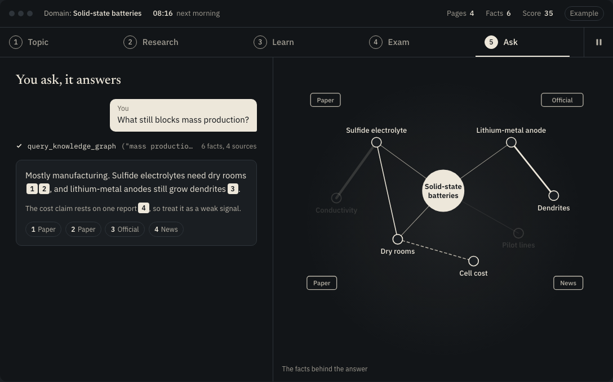
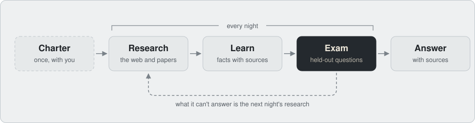

<p align="center"></p>
<h1 align="center">The Sovereign</h1>
<p align="center"><b>A research lab that never stops.</b></p>
<p align="center">
  Give it a topic. Every night it reads the web and the literature, keeps each fact with its source in a knowledge
  graph, and sits an exam to show what it learned. Ask it anything about the topic and it answers from that graph,
  with its sources and how sure it is. Open source and self-hosted, on local models or Claude.
</p>
<p align="center">
  <a href="https://the-sovereign.pages.dev">Website</a> &nbsp;|&nbsp;
  <a href="#quick-start">Quick start</a> &nbsp;|&nbsp;
  <a href="#how-a-night-works">How a night works</a> &nbsp;|&nbsp;
  <a href="#measured">Measured</a> &nbsp;|&nbsp;
  <a href="#docs">Docs</a>
</p>



<p align="center"><sub>From the website's demo of one learning cycle. The demo is an example; the numbers under <a href="#measured">Measured</a> are real records.</sub></p>

## How a night works

<picture>
  <source media="(prefers-color-scheme: dark)" srcset="docs/assets/night-dark.svg">
  
</picture>

You write a research charter with the lab once: what you want to know, what to leave out, how deep. Every night
after that (03:00 by default) it researches, learns, and sits an exam written from sources it is never allowed to
read. The questions it can't answer become the next night's research, so the graph grows where it is weakest.
[More](docs/how-it-works.md)

## Quick start

Needs [Docker](https://docs.docker.com/get-docker/), and either [Ollama](https://ollama.com) for local models or an
[Anthropic API key](https://console.anthropic.com) for Claude.

```bash
git clone https://github.com/cpldxx/the-sovereign.git && cd the-sovereign
./sovereign up
```

The first time, `up` asks whether to think with local models or Claude, then starts everything. Open
http://localhost:8000 and create the first account: it is the admin. Create a domain, a topic, and the Head writes
the charter with you; when you agree, the first research starts.

| | Local (default) | Claude |
|---|---|---|
| What thinks | `qwen3.6:35b` on Ollama | `claude-opus-5-5` |
| Machine | about 24 GB of free memory for the model | anything that runs Docker; no GPU |
| Cost | free | per token; set a spend limit in the console |
| What leaves the machine | searches and page visits | also the pages read and your questions, to Anthropic |

| Command | What it does |
|---|---|
| `./sovereign up` | Starts everything in Docker (`--claude` to skip the question) |
| `./sovereign down` | Stops it; the data stays |
| `./sovereign init --claude` | Switches to Claude (`--local` to switch back) |
| `./sovereign test` | Runs the tests |
| `./sovereign selfcheck` | Checks the running system's security |

Running it for development, reaching it from other devices, every setting: [setup](docs/setup.md).

## What it keeps to

- **It never goes around a block.** No getting past robots.txt, logins, paywalls or bot checks. A page it couldn't
  read is recorded as unread.
- **It weighs its sources.** Papers, then official sources, then news, then blogs. A claim with one source stays a
  weak signal until others confirm it.
- **It doesn't act in the world.** No messages, orders or bookings. It finds out what is true and explains it.
- **It stays on your server.** The graph and its records live on the machine you run it on.

## Measured

Every number comes from the lab's own records.

| Result | What was measured |
|---|---|
| **41 → 55** | Held-out exam score after research missions on the practice questions it got wrong (experiment, test domain) |
| **22 → 35** | The same 30-question exam: its first sitting, and 11 November 2026 |
| **9× faster** | Extraction on a local 35B model with reasoning off: about 19 s instead of 171, at the same quality |
| **47 pages, 1,010 facts** | Read and stored in one night on chip packaging, 11 November 2026 |

Scores move both ways from night to night, and a sitting the model couldn't grade is called off, never counted as a
zero. [The record of one night](docs/how-it-works.md#one-real-night)

## Docs

| Page | What is in it |
|---|---|
| [How it works](docs/how-it-works.md) | One learning cycle, the exam, source tiers, the record of a real night |
| [Setup](docs/setup.md) | Every option of the Docker setup, and running it for development |
| [Models](docs/models.md) | Local or Claude: what each needs, costs and sends out |
| [The app](docs/app.md) | The agents at work, the graph, the Head's chat and voice, briefings, settings |
| [Architecture](docs/architecture.md) | The parts, the ingest pipeline, safeguards, accounts and isolation, the stack |
| [API](docs/api.md) | Every route of the KG API, Research and Hermes, and the MCP tools |
| [Troubleshooting](docs/troubleshooting.md) | Most problems are memory; what to check first |
| [Roadmap](docs/roadmap.md) | What has been built, phase by phase |
| [Contributing](CONTRIBUTING.md) · [Security](SECURITY.md) | Helping out, and reporting a vulnerability |

Built with FastAPI, Pydantic AI, ArcadeDB, DeerFlow, Hermes Agent, SearXNG, crawl4ai and MCP. The app is React,
Vite and Tailwind.

## Credits

- This product includes software developed by UncleCode (https://x.com/unclecode) as part of the Crawl4AI project (https://github.com/unclecode/crawl4ai).
- Entity/fact extraction rules are adapted from [Graphiti](https://github.com/getzep/graphiti) by Zep Software (Apache 2.0).
- Research runs on [DeerFlow](https://github.com/bytedance/deer-flow) (MIT); agents on [Hermes Agent](https://github.com/NousResearch/hermes-agent) (MIT); storage on [ArcadeDB](https://github.com/ArcadeData/arcadedb) (Apache 2.0).
- Web search via a self-hosted, unmodified [SearXNG](https://github.com/searxng/searxng) (AGPL-3.0). If it is ever modified and offered to users over a network, its source must be published.

## License

[MIT](LICENSE). The services it runs keep their own licenses ([the stack](docs/architecture.md#tech-stack)):
SearXNG is AGPL-3.0 and runs unmodified as a separate container.
